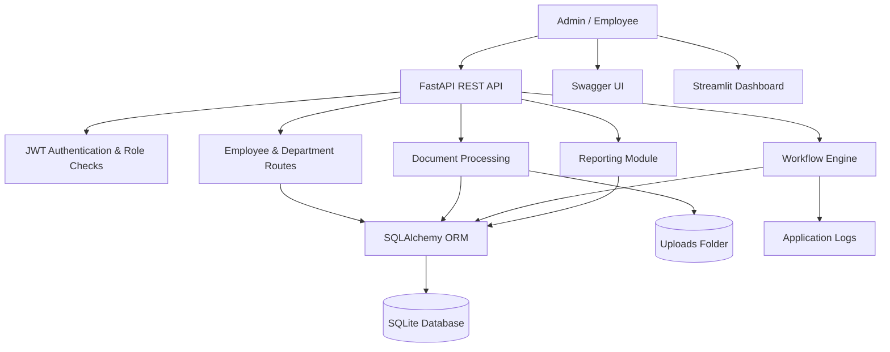

# PY-W4-004 — Technical Documentation

## 1. Purpose
A local-first enterprise workflow demo for employee/department records, document intake and extraction, approval tracking, and operational reports.

## 2. Architecture

## 3. Modules
- `app/`: FastAPI app, configuration, SQLAlchemy models, schemas, authentication, and route handlers.
- `document_processing/`: file validation, PDF/CSV/TXT/DOCX text extraction, keyword classification, and SHA-256 duplicate detection.
- `workflow_engine/`: allowed state transitions, pending notification logging, workflow history, and overdue checks (pending longer than three days).
- `reports/`: PDF report generation helper; API routes also export CSV and JSON.
- `dashboard/`: local Streamlit overview with employee search and CSV downloads.
- `database/schema.sql`: reference relational schema.
- `tests/`: API, document, workflow, and database tests.

## 4. Data Model
`users` authenticate and carry `admin` or `user` roles. `departments` have many `employees`. `documents` belong to an uploading user. `workflows` may reference a document and creator. `workflow_activities` records submission and decisions for each workflow.

## 5. Security and roles
Passwords are hashed with Argon2 through `pwdlib`; API access uses signed JWT bearer tokens. The first account registered in a fresh local database is assigned `admin`; later accounts are `user`. Employee/department write operations and workflow decisions require admin. Any authenticated account can submit documents and workflows. This first-account bootstrap is for a local internship demo only; a public deployment must provision the initial administrator out-of-band and disable public admin bootstrap. Use a strong random `SECRET_KEY` in `.env`.

## 6. Document pipeline
The API accepts `.pdf`, `.csv`, `.txt`, and `.docx` up to 10 MB. It validates extension and size, calculates SHA-256, rejects duplicate content, extracts text, assigns a keyword-based category, stores a UUID-named file, and records metadata. Extension checks are not malware scanning or cryptographic file-type verification; do not expose this demo to untrusted public uploads.

## 7. Workflow lifecycle
`Pending -> Approved` or `Pending -> Rejected`. Approved and rejected states are terminal. Each submission/decision writes a workflow activity row. Pending notification events are written to the application log. Optional SMTP email delivery is available when the SMTP and recipient variables are configured in `.env`; SMS is not configured. A workflow is considered overdue after three days pending.

## 8. API overview
- `POST /auth/register`, `POST /auth/login`
- `GET/POST /departments`
- `GET/POST /employees`, `GET/PUT/DELETE /employees/{employee_id}`
- `POST/GET /documents`
- `POST/GET /workflows`, `POST /workflows/{id}/decision`, `GET /workflows/{id}/history`, `GET /workflows/overdue`
- `GET /reports/summary`, `/reports/summary.json`, `/reports/employees.csv`, `/reports/summary.pdf`

Interactive API docs: `/docs`.

## 9. Local setup and execution
See `README.md`. Recommended Python 3.11 or 3.12. Install dependencies from `requirements.txt`, create `.env` from `.env.example`, run `python run.py`, and open `http://127.0.0.1:8000/docs`. Run dashboard in another terminal using `streamlit run dashboard/admin_dashboard.py`. Generate periodic report files using `python -m reports.scheduled_report` and schedule that command with Windows Task Scheduler or cron. Create a SQLite backup using `python -m database.backup`. Run tests using `pytest -q`.

## 10. Testing and known scope limits
Tests cover health/OpenAPI availability, document validation/extraction/classification, workflow transitions, and database relationships. Run the full test suite in the target Python environment after installing dependencies. This is an educational reference implementation, not a production-hardened enterprise service. Production work still includes migrations, rate limiting, malware scanning, robust MIME/signature validation, scheduled background jobs, real email delivery, dashboard authentication, backup/restore automation, deployment secrets, and broader integration/load tests.
